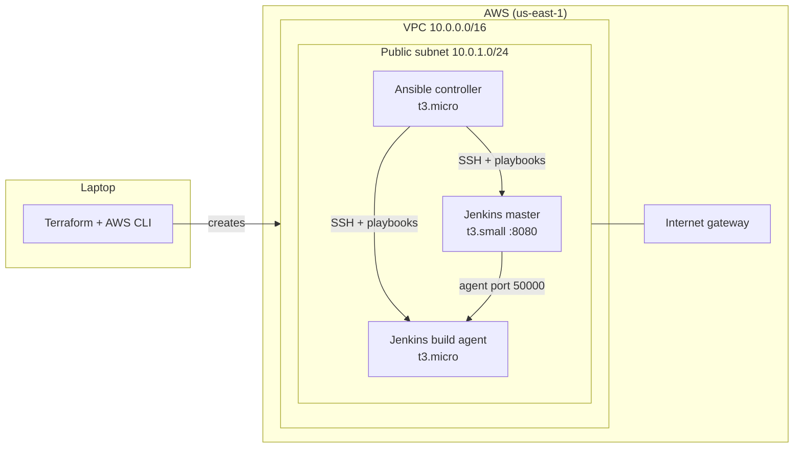

# Jenkins CI/CD Lab on AWS (Terraform + Ansible)

Build a three-server Jenkins lab on AWS: an Ansible controller, a Jenkins master and a build agent. Terraform provisions the infrastructure, Ansible connects to the servers and installs the software.

The infrastructure guide below is followed by the original app and pipeline steps. The repository contains code, not a claim that AWS, Jenkins or Kubernetes is currently running.

## Architecture



Security group: SSH (22) and the Jenkins UI (8080) are open only to your own IP; the Jenkins agent port (50000) is open only inside the VPC; all outbound traffic is allowed.

## What is in this repo

| Path | What it does |
| --- | --- |
| `terraform/` | VPC, subnet, internet gateway, routing, security group, key pair and the three EC2 instances |
| `terraform/terraform.tfvars.example` | Copy this to `terraform.tfvars` and put in your own public IP |
| `ansible/inventory.ini` | Ansible inventory for the master and agent (fill in their private IPs) |
| `ansible/site.yml` | Playbook: Java 21 + Git everywhere, Maven on the agent, Jenkins on the master |
| `terraform/README.txt` | Cost notes and the destroy reminder |

## Before you start

You need Git Bash (or a Linux shell), Terraform, the AWS CLI and an AWS account with permission to create EC2/VPC resources. Configure AWS credentials locally with `aws configure`.

Never put credentials, private keys or Terraform state in a repository. The `.gitignore` in this repo already excludes them.

## 1. Plan and create the infrastructure

Restrict SSH and Jenkins access to your current public IP. Keep `terraform.tfvars` local and review the plan before approving any AWS charges.

```bash
cd terraform
aws sts get-caller-identity
echo "my_ip = \"$(curl -s https://checkip.amazonaws.com)/32\"" > terraform.tfvars
terraform init
terraform plan
terraform apply
```

Enter `yes` only after reviewing the plan. It creates 12 resources and prints the three public IPs. Save them in the same shell:

```bash
export CIP=$(terraform output -raw ansible_controller_public_ip)
export MIP=$(terraform output -raw jenkins_master_public_ip)
export AIP=$(terraform output -raw jenkins_agent_public_ip)
```

## 2. Connect to the Ansible controller

```bash
chmod 600 project06-key.pem
ssh -i project06-key.pem ec2-user@$CIP
```

Check the SSH host fingerprint before accepting a new host. On the controller, install Ansible and create a dedicated key pair:

```bash
sudo dnf install -y ansible-core
ansible --version
ssh-keygen -t ed25519 -f ~/.ssh/id_ed25519
```

For a disposable lab, an empty passphrase avoids interactive prompts; protect the controller and delete the key after the lab. Production systems need an approved key-management approach.

## 3. Copy only the public key to the laptop

Leave the controller session, then run this from the laptop's Terraform directory:

```bash
exit
scp -i project06-key.pem ec2-user@$CIP:.ssh/id_ed25519.pub controller.pub
```

The `.pub` file is the public key. Never copy or share the controller's private key.

## 4. Authorize the controller on both servers

On the laptop, add the controller's public key to the master and agent. These commands also print their private IPs. Note both private IPs for the inventory.

```bash
for ip in $MIP $AIP; do
  cat controller.pub | ssh -i project06-key.pem ec2-user@$ip \
    'umask 077; mkdir -p ~/.ssh; cat >> ~/.ssh/authorized_keys;
     chmod 700 ~/.ssh; chmod 600 ~/.ssh/authorized_keys; hostname -I'
done
```

## 5. Create the inventory on the controller

```bash
ssh -i project06-key.pem ec2-user@$CIP
mkdir -p ~/project && cd ~/project
vim inventory.ini
```

Paste the inventory from `ansible/inventory.ini`. Replace both placeholders with the current **private** IPs from step 4, not the public IPs.

## 6. Verify SSH, then test Ansible

Connect once to each server from the controller. Check and accept the correct host fingerprints, then run the ping module:

```bash
ssh -i ~/.ssh/id_ed25519 ec2-user@MASTER_PRIVATE_IP hostname
ssh -i ~/.ssh/id_ed25519 ec2-user@AGENT_PRIVATE_IP hostname
ansible -i inventory.ini all -m ansible.builtin.ping
```

Expected: both hosts return `SUCCESS` with `pong`. This checks SSH and Python connectivity; it is not an ICMP ping or a Jenkins installation.

## Common fixes

- **PEM not found:** run the laptop SSH commands from the Terraform directory.
- **Timeout:** check the security-group rules and the current public/private IPs. Public IPs change when instances are stopped and started; update the inventory and the exported variables.
- **Permission denied:** check `ec2-user`, the key path and `authorized_keys` permissions.
- **Your IP changed:** update `my_ip` in `terraform.tfvars` and run `terraform apply` again.

## App and pipeline files

- `app/`: Java 21 HTTP service and five dependency-free HTTP checks.
- `Dockerfile`, `.dockerignore`: multi-stage build, tests during build, non-root runtime.
- `Jenkinsfile`: checkout, tests, optional SonarQube gate, image build, container smoke test, optional publish and approved deploy.
- `test.sh`, `deploy.sh`: repeatable test and deployment commands.
- `k8s/app.yaml`: namespace, two-replica deployment, health probes, resource limits and internal service.
- `ansible/agent-tools.yml`: Docker setup for the existing build agent.
- `sonar-project.properties`: optional SonarQube project settings.

### 7. Prepare Jenkins and the build agent

Run from the Ansible controller with these playbooks beside the existing inventory:

```bash
ansible-playbook -i inventory.ini site.yml
ansible-playbook -i inventory.ini agent-tools.yml
```

The second playbook grants `ec2-user` Docker access, equivalent to root access. Use only on this disposable, trusted lab agent. Reconnect/restart its Jenkins agent process after the group change. Do not run builds on the Jenkins master.

Finish Jenkins setup through its restricted UI. Install Pipeline, Git and Credentials Binding plugins. Create a permanent node with remote directory `/home/ec2-user/jenkins-agent`, label `docker-agent`, one executor and Java 21. Use Jenkins' generated inbound-agent command on the agent, with the master private IP and a secret stored only on the agent. Keep TCP 50000 private to the VPC. Check the node is online and can run `java -version`, `javac -version` and `docker version` as its actual agent user.

Create a Pipeline from SCM job for this private repository, branch `main`, script `Jenkinsfile`. Use a Jenkins GitHub read credential for checkout, never a token inside a file or repository URL. The first run creates the parameters; publish/deploy are off by default.

### 8. Run the app and container locally

From the repository root, with a Java 21 JDK:

```bash
sh test.sh
java app/App.java
# In another terminal:
curl -f http://127.0.0.1:8080/healthz
curl -f http://127.0.0.1:8080/metrics
```

Stop Java before reusing port 8080. On the build agent, Jenkins already uses port 8080 on a different server. To test Docker manually:

```bash
docker build -t pipeline-lab:local .
docker run --rm --name pipeline-lab -p 127.0.0.1:8081:8080 pipeline-lab:local
# Another terminal:
curl -f http://127.0.0.1:8081/healthz
# Stop with Ctrl+C.
```

### 9. Publish and optional quality scan

Create a Docker Hub repository. Add Jenkins username/password credential `dockerhub`, using your Docker Hub username and a scoped access token. Run with `PUBLISH=true` and `IMAGE_REPOSITORY=YOUR_NAMESPACE/pipeline-lab`. Images are tagged with the full Git commit SHA. Registry publishing can expose the image independently of this private source repository; choose the intended registry visibility first.

For SonarQube, provide a reachable server, install its Jenkins plugin, configure server `lab-sonarqube` and tool `SonarScanner`, and set its webhook to `JENKINS_URL/sonarqube-webhook/` with a matching webhook secret. Then enable `SONAR_SCAN`. It blocks on a failed quality gate. No SonarQube server is created here, and no coverage percentage is claimed.

### 10. Deploy to an existing Kubernetes cluster

The current Terraform creates three EC2 servers only. It does not create EKS, Kubernetes, IAM for cluster access or monitoring. Provisioning any paid cluster is a separate, reviewed decision. A local cluster works for learning too.

Install a cluster-compatible `kubectl` on the agent. Verify its checksum using the official Kubernetes installation instructions. Add a least-privilege kubeconfig as Jenkins secret-file credential `lab-kubeconfig`. For EKS, also install AWS CLI and use an approved short-lived IAM role with the necessary cluster access. The agent needs network access to the API endpoint. This manifest includes namespace creation; have an administrator pre-create `pipeline-lab` if namespace creation is restricted.

For private images, create a Docker registry pull secret in `pipeline-lab` outside Git and add `imagePullSecrets` to the pod spec before deployment. The Jenkins push credential does not authenticate Kubernetes pulls.

Run the pipeline with `PUBLISH=true`, `DEPLOY=true` and the image repository. It waits for approval, prints the kubeconfig context, renders the exact SHA-tagged image and waits for rollout. Review the credential's context before approving. The checked-in manifest is a template, do not apply it with `IMAGE_PLACEHOLDER` unchanged.

Manual equivalent, using your local kubeconfig and an image already pushed:

```bash
sh deploy.sh YOUR_NAMESPACE/pipeline-lab:FULL_40_CHARACTER_GIT_SHA
kubectl -n pipeline-lab port-forward service/pipeline-lab 8081:80
# Another terminal:
curl -f http://127.0.0.1:8081/healthz
curl -f http://127.0.0.1:8081/metrics
```

The service is internal, not a paid cloud load balancer. For monitoring, configure your existing Prometheus to scrape the annotated pods on `/metrics`, then graph `sum(rate(lab_http_requests_total[5m]))` in Grafana. Annotations require a matching Prometheus scrape configuration; they do not install monitoring by themselves.

If rollout fails, inspect `kubectl -n pipeline-lab describe pods` and `kubectl -n pipeline-lab logs deployment/pipeline-lab`. To roll back an existing deployment revision: `kubectl -n pipeline-lab rollout undo deployment/pipeline-lab`, then wait for rollout again. Re-deploy the prior known-good SHA if no previous revision exists.

### Validation boundary

The Java 21 compile and five HTTP checks were run locally. Shell syntax and YAML parsing were checked. Docker build, Jenkins execution, SonarQube, Ansible execution and Kubernetes deployment still need to be run in the configured lab. Mutable Java base-image tags are convenient for learning; pin reviewed digests for a repeatable production build. This is a learning baseline, not production infrastructure.

## Cleanup: do not leave the lab running

From the laptop's Terraform directory, review and confirm destruction. Stopping EC2 instances does not remove storage charges. If later stages create Kubernetes or other resources outside this Terraform state, remove those separately first.

```bash
terraform plan -destroy
terraform destroy
```

For resources added by this app, stop port-forwards and review `kubectl -n pipeline-lab get all`. Delete only this dedicated lab namespace when finished: `kubectl delete namespace pipeline-lab`. This deletes everything in that namespace. Remove test images from the agent with `docker image rm IMAGE:TAG` when no longer needed. Remove separately created cluster/monitoring resources through their own provisioning method before destroying the EC2 lab.

Then check the AWS console for remaining billable resources, including volumes, Elastic IPs and load balancers.

## Credits

Tutorial and Terraform/Ansible adaptation by **DevOpsVibez**.
