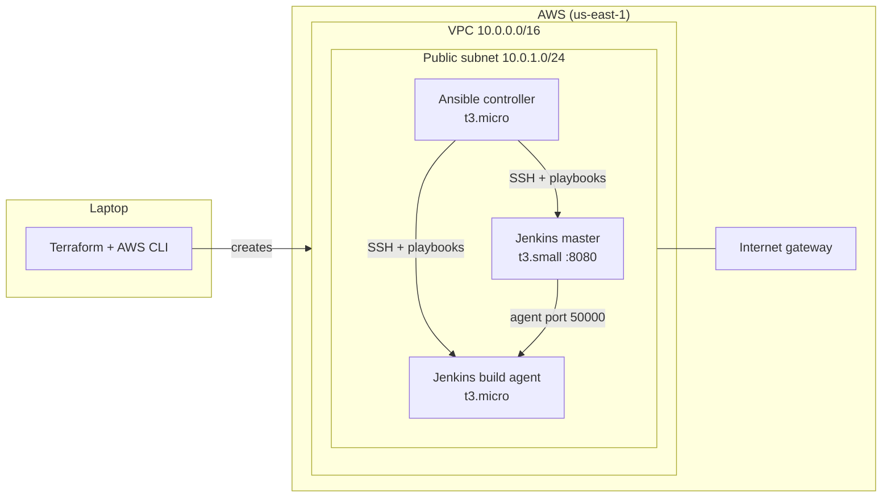

# Jenkins CI/CD Lab on AWS (Terraform + Ansible)

Build a three-server Jenkins lab on AWS: an Ansible controller, a Jenkins master and a build agent. Terraform provisions the infrastructure, Ansible connects to the servers and installs the software.

This guide covers Part 1: provisioning the infrastructure and testing Ansible connectivity. Jenkins installation, the CI/CD pipeline, EKS and monitoring come next (see **Next steps**).

## Architecture



Security group: SSH (22) and the Jenkins UI (8080) are open only to your own IP; the Jenkins agent port (50000) is open only inside the VPC; all outbound traffic is allowed.

## What is in this repo

| Path | What it does |
| --- | --- |
| `terraform/` | VPC, subnet, internet gateway, routing, security group, key pair and the three EC2 instances |
| `terraform/terraform.tfvars.example` | Copy this to `terraform.tfvars` and put in your own public IP |
| `ansible/inventory.ini` | Ansible inventory for the master and agent (fill in their private IPs) |
| `ansible/site.yml` | Playbook: Java 21 + Git everywhere, Maven on the agent, Jenkins on the master |
| `terraform/README.txt` | Cost notes and the destroy reminder |

## Before you start

You need Git Bash (or a Linux shell), Terraform, the AWS CLI and an AWS account with permission to create EC2/VPC resources. Configure AWS credentials locally with `aws configure`.

Never put credentials, private keys or Terraform state in a repository. The `.gitignore` in this repo already excludes them.

## 1. Plan and create the infrastructure

Restrict SSH and Jenkins access to your current public IP. Keep `terraform.tfvars` local and review the plan before approving any AWS charges.

```bash
cd terraform
aws sts get-caller-identity
echo "my_ip = \"$(curl -s https://checkip.amazonaws.com)/32\"" > terraform.tfvars
terraform init
terraform plan
terraform apply
```

Enter `yes` only after reviewing the plan. It creates 12 resources and prints the three public IPs. Save them in the same shell:

```bash
export CIP=$(terraform output -raw ansible_controller_public_ip)
export MIP=$(terraform output -raw jenkins_master_public_ip)
export AIP=$(terraform output -raw jenkins_agent_public_ip)
```

## 2. Connect to the Ansible controller

```bash
chmod 600 project06-key.pem
ssh -i project06-key.pem ec2-user@$CIP
```

Check the SSH host fingerprint before accepting a new host. On the controller, install Ansible and create a dedicated key pair:

```bash
sudo dnf install -y ansible-core
ansible --version
ssh-keygen -t ed25519 -f ~/.ssh/id_ed25519
```

For a disposable lab, an empty passphrase avoids interactive prompts; protect the controller and delete the key after the lab. Production systems need an approved key-management approach.

## 3. Copy only the public key to the laptop

Leave the controller session, then run this from the laptop's Terraform directory:

```bash
exit
scp -i project06-key.pem ec2-user@$CIP:.ssh/id_ed25519.pub controller.pub
```

The `.pub` file is the public key. Never copy or share the controller's private key.

## 4. Authorize the controller on both servers

On the laptop, add the controller's public key to the master and agent. These commands also print their private IPs. Note both private IPs for the inventory.

```bash
for ip in $MIP $AIP; do
  cat controller.pub | ssh -i project06-key.pem ec2-user@$ip \
    'umask 077; mkdir -p ~/.ssh; cat >> ~/.ssh/authorized_keys;
     chmod 700 ~/.ssh; chmod 600 ~/.ssh/authorized_keys; hostname -I'
done
```

## 5. Create the inventory on the controller

```bash
ssh -i project06-key.pem ec2-user@$CIP
mkdir -p ~/project && cd ~/project
vim inventory.ini
```

Paste the inventory from `ansible/inventory.ini`. Replace both placeholders with the current **private** IPs from step 4, not the public IPs.

## 6. Verify SSH, then test Ansible

Connect once to each server from the controller. Check and accept the correct host fingerprints, then run the ping module:

```bash
ssh -i ~/.ssh/id_ed25519 ec2-user@MASTER_PRIVATE_IP hostname
ssh -i ~/.ssh/id_ed25519 ec2-user@AGENT_PRIVATE_IP hostname
ansible -i inventory.ini all -m ansible.builtin.ping
```

Expected: both hosts return `SUCCESS` with `pong`. This checks SSH and Python connectivity; it is not an ICMP ping or a Jenkins installation.

## Common fixes

- **PEM not found:** run the laptop SSH commands from the Terraform directory.
- **Timeout:** check the security-group rules and the current public/private IPs. Public IPs change when instances are stopped and started; update the inventory and the exported variables.
- **Permission denied:** check `ec2-user`, the key path and `authorized_keys` permissions.
- **Your IP changed:** update `my_ip` in `terraform.tfvars` and run `terraform apply` again.

## Next steps

- Install Jenkins and Java 21 with `ansible/site.yml` (included, written for Amazon Linux 2023): `ansible-playbook -i inventory.ini site.yml`
- Connect the build agent to the Jenkins master (port 50000)
- Add the pipeline stages: Maven tests, SonarQube code scanning, Docker image build and publish
- EKS deployment and Prometheus/Grafana monitoring are separate stages with additional costs

## Cleanup: do not leave the lab running

From the laptop's Terraform directory, review and confirm destruction. Stopping EC2 instances does not remove storage charges. If later stages create Kubernetes or other resources outside this Terraform state, remove those separately first.

```bash
terraform plan -destroy
terraform destroy
```

Then check the AWS console for remaining billable resources, including volumes, Elastic IPs and load balancers.

## Credits

Tutorial and Terraform/Ansible adaptation by **DevOpsVibez**.

Based on Project 06 from [NotHarshhaa/DevOps-Projects](https://github.com/NotHarshhaa/DevOps-Projects), adapted for an Amazon Linux learning lab. The original project's files are not copied here; please get them from the original repository.
